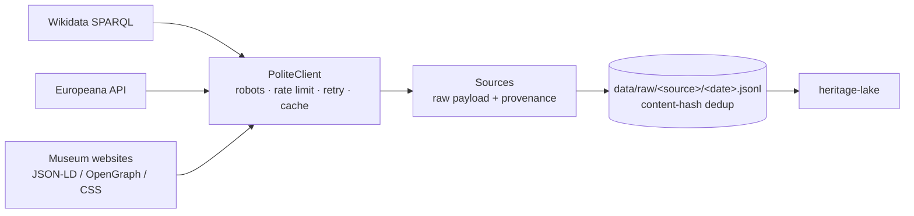

# heritage-harvest

Polite, resumable harvesting of cultural-heritage records from **SPARQL endpoints, REST APIs and museum websites** into a provenance-preserving raw zone.

This is stage 1 of a three-repo pipeline that turns scattered, unstructured heritage data into one reliable dataset and a multimodal embedding space:

| Stage | Repo | What it does |
|---|---|---|
| **1. Harvest** | **heritage-harvest** (this repo) | Scrape and collect raw records, with provenance |
| 2. Integrate | [heritage-lake](https://github.com/jaogye/heritage-lake) | Clean, resolve entities, merge with in-house data, quality-gate |
| 3. Embed | [heritage-atlas](https://github.com/jaogye/heritage-atlas) | Multimodal (image + text) embedding space, clusters, relationships |

The running example is **artworks held in Belgian collections** (Brussels, Bruges, Ghent, Antwerp, Leuven…), pulled from Wikidata, Europeana and museum collection websites.



## Quick start

```bash
pip install -e ".[dev]"
harvest wikidata --limit 2000          # artworks in Belgian collections
harvest europeana --query "Bruegel"    # set EUROPEANA_API_KEY for more than demo volumes
harvest crawl https://<museum>/collection --detail '/object/\d+' --follow '[?&]page=' --name museum_x
pytest                                  # 21 tests, no network needed
```

Every source writes the same record shape:

```json
{"source": "wikidata", "source_id": "Q…", "url": "https://www.wikidata.org/wiki/Q…",
 "fetched_at": "2026-10-18T09:12:44Z", "payload": { "...upstream data, untouched..." },
 "content_hash": "sha256 of canonical payload"}
```

## Design decisions

**Keep the raw payload untouched.** Sources never interpret dates, names or places. Parsing "ca. 1520–1530" or reconciling "P. Bruegel I" with "Pieter Bruegel the Elder" happens in heritage-lake, where a bug costs a re-run of a transform, not a re-scrape of thousands of pages.

**Content-hash deduplication makes the raw zone a change log.** Re-running a harvest appends only records whose content changed. Downstream can replay history, and a weekly re-harvest is cheap.

**Being a good citizen is built into the client, not left to each scraper.** `PoliteClient` serialises requests per host, enforces a minimum interval, honours `robots.txt` for crawling (5xx on robots.txt is treated as *disallow*), backs off exponentially on 429/5xx and honours `Retry-After`. Official APIs opt out of robots checks per call and are governed by their own usage terms instead.

**Resumable by default.** An on-disk HTTP cache means a crash at page 3,000 restarts from the cache, not from page 1.

**Structured data first, HTML last.** The web crawler prefers schema.org JSON-LD (most stable across redesigns), falls back to OpenGraph, and only then to per-site CSS selectors. Broken JSON-LD blocks, which are common, are skipped rather than fatal.

**SPARQL row explosion is fixed at the edge.** An artwork with 2 creators and 2 materials comes back as 4 rows. The Wikidata source folds rows into one record and correctly merges items whose rows straddle a page boundary (covered by a test).

## Project layout

```
src/harvest/
  http.py            PoliteClient: robots, per-host rate limit, retries, cache
  models.py          RawRecord + canonical content hash
  sinks.py           append-only JSONL sink with dedup
  sources/
    wikidata.py      SPARQL with row folding and page-boundary merge
    europeana.py     cursor-based deep pagination
    jsonld.py        bounded BFS crawler + JSON-LD/OpenGraph/CSS extraction
  cli.py             `harvest` command
tests/               respx-mocked HTTP, fixtures, no network
```

## Adding a source

A source is any object with a `name` and an async `records(limit)` generator that yields `RawRecord`s. See `.claude/commands/add-source.md` for the checklist used when adding sources with an agentic coding assistant.

## Ethics and rights

Harvesting stays within each provider's terms: `robots.txt` for websites, published usage policies for APIs, a descriptive User-Agent with a contact URL, and conservative request rates. Rights statements (e.g. Europeana `rights`, Wikimedia Commons licences) are kept in the payload so downstream stages can filter by reuse rights before images are downloaded or embedded.

## Working with agentic coding tools

This repo was built with an AI coding assistant in the loop. `CLAUDE.md` holds the project conventions the assistant follows (test-first with fixtures, no live network in tests, raw payloads untouched), and `.claude/commands/` holds reusable task prompts. Every change is still reviewed and covered by tests.

## License

MIT
